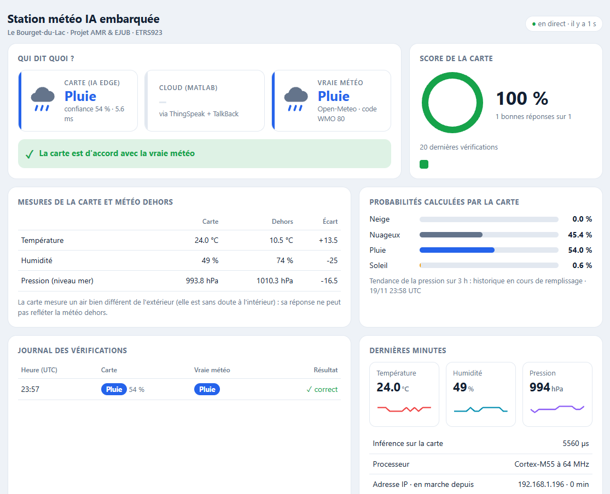
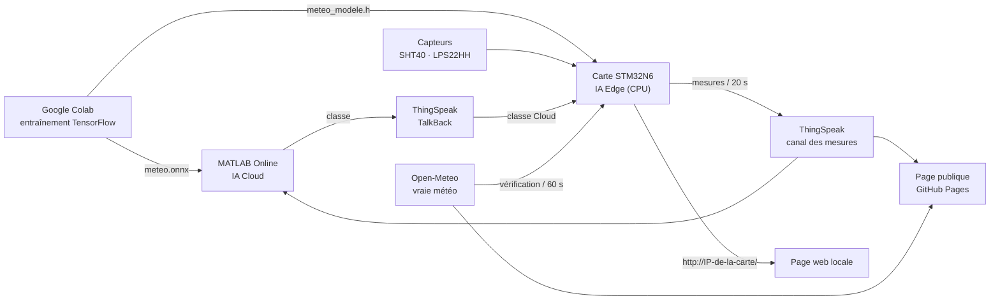
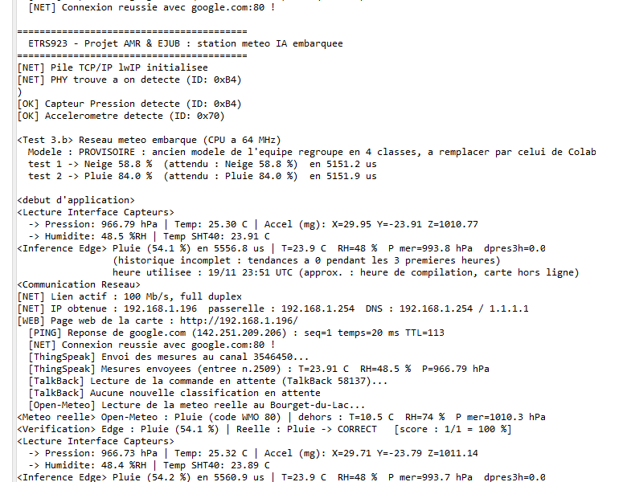

# Station météo IA embarquée — STM32N6

**Projet AMR & EJUB · ETRS923 « IA et objets connectés » · Université Savoie Mont Blanc**

Une carte STM32N6 mesure la température, l'humidité et la pression, puis un réseau de neurones **exécuté directement sur la carte** (Edge AI) classe la météo en **Soleil, Nuageux, Pluie ou Neige**. Le même modèle tourne aussi **dans le Cloud** (ThingSpeak + MATLAB) : la carte compare les deux réponses, puis les confronte à **la vraie météo** (Open-Meteo). Tout est visible en direct sur une **page web servie par la carte**.

### 🌐 Tableau de bord public : **https://ahmetiejub.github.io/IA-embarque/**

Résultats en direct depuis n'importe où (la page lit ThingSpeak et Open-Meteo). Sur le réseau local, la carte sert aussi sa propre page sur `http://IP-de-la-carte/`.



---

## Résultats

| | Edge (carte STM32N6) | Cloud (ThingSpeak + MATLAB) |
|---|---|---|
| Classe trouvée | identique au Cloud | identique à la carte |
| Temps de calcul | **≈ 5,6 ms** (Cortex-M55 à 64 MHz, float32, sans optimisation) | ≈ 1 ms |
| Délai jusqu'à la réponse sur la carte | ≈ 5,6 ms | plusieurs secondes (aller-retour réseau) |
| Fonctionne sans Internet | **oui** | non |

- **Fidélité du portage** : sur des échantillons de test, la carte donne les mêmes probabilités que le modèle ONNX au dixième près (Neige 58,8 %, Pluie 84,0 %).
- **Précision du modèle actuel** : 28 bonnes réponses sur 50 échantillons de test en 4 classes (**56 %**, contre 25 % au hasard) ; la pluie est reconnue dans 75 % des cas. Échantillon réduit (50 heures d'hiver) : à confirmer sur une année complète avec le notebook 2.
- **Taille du modèle** : 12 → 32 → 16 → 5 neurones, 1 029 paramètres, ≈ 4 Ko.

---

## Architecture



1. **Entraînement (Cloud, une fois)** — Colab télécharge plusieurs années de météo horaire (MeteoStat), entraîne un réseau dense avec TensorFlow et l'exporte en ONNX.
2. **Inférence Edge** — la carte lit ses capteurs, calcule les entrées (pression ramenée au niveau de la mer, point de rosée, tendances) et exécute le réseau en C sur le Cortex-M55.
3. **Inférence Cloud** — la carte publie ses mesures sur ThingSpeak ; un script MATLAB les classe avec le même `meteo.onnx` et renvoie la classe par TalkBack.
4. **Vérification** — la carte interroge Open-Meteo, convertit le code météo WMO en nos 4 classes et tient un score.

---

## Fonctionnalités

- **IA embarquée sur le CPU** : réseau dense écrit en C (`meteo_reseau.c`), poids générés depuis Colab (`meteo_modele.h`) ; résultats identiques à l'ONNX.
- **Comparaison Edge / Cloud** en direct (`<Comparaison> Cloud : Pluie | Edge : Pluie -> IDENTIQUES`).
- **Vérification avec la vraie météo** (Open-Meteo, HTTP, sans clé) et score cumulé.
- **Mode hors ligne** : la carte classe même sans réseau (heure de compilation en secours, recalée sur Internet dès que possible).
- **Réseau robuste** : DHCP, DNS de secours, détection et rejet d'un serveur DHCP sans accès Internet, buffers DMA Ethernet à adresse fixe.
- **Démarrage autonome** : le FSBL copie l'application depuis la flash externe (XSPI2) en RAM ; la carte repart seule après une coupure de courant (`firmware/Demarrage_autonome/`).
- **Page publique** (GitHub Pages, `docs/index.html`) : mêmes résultats accessibles depuis Internet via ThingSpeak (champs 4 à 7 : classe Edge, confiance, vraie météo, score).
- **Page web embarquée** (port 80) : classe et probabilités, comparaison carte / Cloud / réel, mesures carte vs dehors, journal des vérifications, courbes.



---

## Contenu du dépôt

```
.
├── firmware/                     Projet STM32CubeIDE (NUCLEO-N657X0-Q)
│   ├── amr-ejub.ioc              Configuration CubeMX
│   ├── Appli/Core/Src/
│   │   ├── app_freertos.c        Boucle principale : capteurs, IA Edge, ThingSpeak, TalkBack, Open-Meteo
│   │   ├── meteo_features.c      Entrées de l'IA : pression mer, point de rosée, historique, tendances, heure
│   │   ├── meteo_reseau.c        Réseau de neurones en C (couches denses, ReLU, softmax)
│   │   ├── web_serveur.c         Serveur web embarqué (/ et /data.json)
│   │   ├── ethernetif.c          Ethernet, DHCP, choix du serveur, console série
│   │   └── stm32n6xx_hal_msp.c   Broches, droits d'accès (RIF) et horloges Ethernet
│   ├── Appli/Core/Inc/
│   │   ├── meteo_modele.h        Modèle : entrées, classes, 1 029 poids (généré par Colab)
│   │   ├── thingspeak_keys.example.h   Modèle du fichier des clés API
│   │   ├── lwipopts.h · FreeRTOSConfig.h
│   └── Web/page.html             Page web (convertie en web_page.h par generer_page.py)
├── colab/
│   ├── 1_modele_equipe_5_classes.ipynb     Modèle actuel (12 entrées, 5 classes)
│   └── 2_modele_capteurs_4_classes.ipynb   Nouveau modèle : capteurs seuls, 4 classes, génère meteo_modele.h
├── matlab/tp3_classification_boucle.m      Classification Cloud (ThingSpeak → ONNX → TalkBack)
├── modele/                       meteo.onnx, labels.json, features.json, echantillons_test.csv
├── firmware/Demarrage_autonome/  Script de signature + flash pour démarrer sans PC
└── docs/
    ├── index.html                Tableau de bord public (GitHub Pages)
    ├── Schema_station_meteo_AMR_EJUB.pptx   Schéma du système pour la présentation
    └── img/                      Captures
```

---

## Mise en route

### Matériel
- Carte **NUCLEO-N657X0-Q** (STM32N657, Cortex-M55) + capteurs **SHT40** (température, humidité) et **LPS22HH** (pression), accéléromètre LSM6DSO.
- Câble Ethernet vers une box ou un routeur avec DHCP.

### 1. Clés ThingSpeak
1. Créer un canal « mesures » (field1 = température, field2 = humidité, field3 = pression), un canal « résultats » et un TalkBack.
2. Copier `firmware/Appli/Core/Inc/thingspeak_keys.example.h` en **`thingspeak_keys.h`** et y mettre ses clés.
   Ce fichier est ignoré par Git.

### 2. Firmware
1. STM32CubeIDE → *File → Import → Existing Projects into Workspace* → dossier `firmware/`.
2. *Clean*, *Build*, puis *Run* en mode **Dev_Boot**.
3. La console série (115 200 bauds) affiche les tests, les inférences et l'adresse de la page web :
   `[WEB] Page web de la carte : http://192.168.1.x/`.

Réglages réseau (adresse fixe en option) : `firmware/Appli/Core/Inc/ethernetif.h`. Fuseau horaire pour le mode hors ligne : `METEO_DECALAGE_UTC_H` dans `meteo_features.h`.

### 3. Classification Cloud (MATLAB Online)
1. Déposer `modele/meteo.onnx`, `modele/labels.json`, `modele/features.json` et `matlab/tp3_classification_boucle.m` dans MATLAB Drive.
2. Renseigner les clés en haut du script, puis l'exécuter (arrêt : Ctrl+C).

### 4. Réentraîner le modèle (Google Colab)
1. Ouvrir `colab/2_modele_capteurs_4_classes.ipynb` dans Colab → *Exécution → Tout exécuter* (≈ 30 min).
2. Remplacer `firmware/Appli/Core/Inc/meteo_modele.h` par le fichier téléchargé (aucun autre changement de code), et mettre à jour les fichiers de `modele/` pour MATLAB.

---

## Choix techniques

- **CPU plutôt que NPU** : le réseau compte 1 152 multiplications-additions ; le Cortex-M55 l'exécute en quelques millisecondes, alors que le NPU Neural-ART vise des réseaux de plusieurs millions d'opérations (images, audio).
- **Réseau écrit en C plutôt que généré par X-CUBE-AI** : ST Edge AI Developer Cloud a servi à analyser le modèle (1 152 MACC, 4 Ko de poids), mais la génération de code n'a pas abouti. Le portage manuel est validé par des tests de non-régression contre l'ONNX.
- **ReLU** dans les couches cachées (simple, rapide sur microcontrôleur), **softmax** en sortie (une probabilité par classe).
- **Découpage temporel** à l'entraînement : apprentissage sur les années passées, test sur 2024.

---

## Limites et suites

- Le modèle actuel utilise la position et l'heure ; le **notebook 2** entraîne un modèle à 4 classes qui n'utilise que les capteurs et leurs tendances (1, 3 et 6 h).
- La carte doit mesurer **l'air extérieur** pour que la vérification avec la vraie météo soit significative.
- Pistes : capteur de luminosité (distinguer soleil et nuages), passage à une fréquence CPU plus élevée et compilation optimisée, mesure de consommation (TP3 3.d).

---

## Correspondance avec les TP

| TP | Contenu | Dans ce dépôt |
|---|---|---|
| TP2 | FreeRTOS, capteurs, Ethernet, lwIP, ping | `firmware/` |
| TP3 partie 1 | Entraînement Cloud, export ONNX | `colab/1_modele_equipe_5_classes.ipynb`, `modele/` |
| TP3 partie 2 | ThingSpeak, MATLAB, TalkBack | `matlab/`, `firmware/.../app_freertos.c` |
| TP3 partie 3 | Inférence Edge, comparaison Cloud / Edge | `firmware/.../meteo_*.c`, `meteo_modele.h` |
| Bonus | 4 classes, hors ligne, vraie météo, réseau robuste, page web | `firmware/`, `colab/2_...` |

---

*Projet réalisé par l'équipe AMR & EJUB dans le cadre du module ETRS923.*
